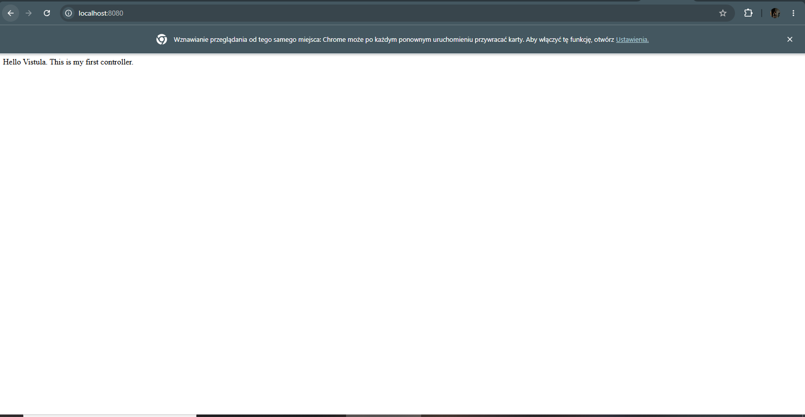
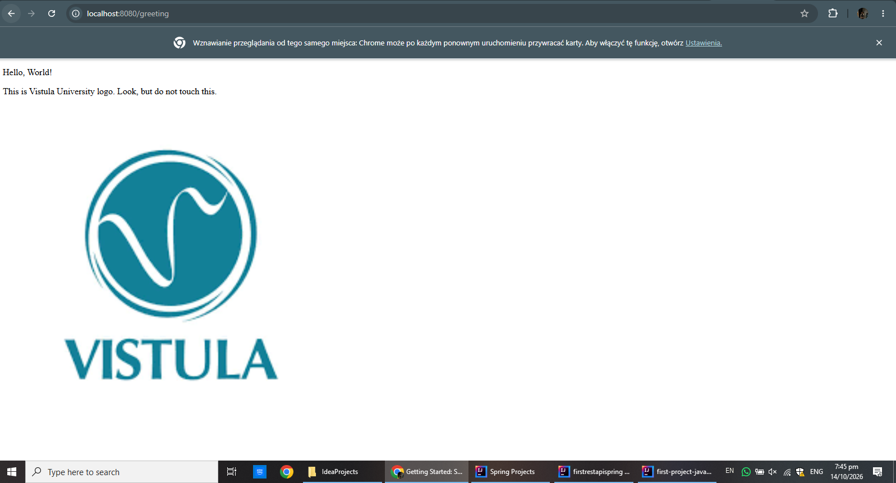
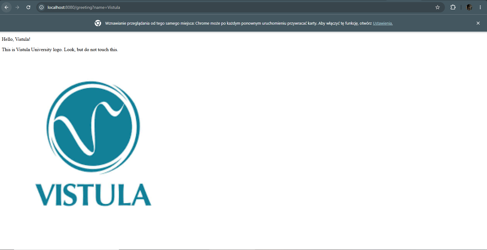

# Task 1 — First Java Spring Boot Application
# By Nokutenda Prince Mahembe 64215
## 1. Project Overview

This project is my first application developed using Java and the Spring Boot framework. It demonstrates how to create a Spring Boot project, write a controller, handle HTTP requests, and display a web page using Thymeleaf.

The project also demonstrates the use of the `@Controller`, `@ResponseBody`, `@GetMapping`, `@RequestParam`, and `Model` features of Spring.

## 2. Technologies Used

- Java
- Spring Boot
- Spring Web
- Thymeleaf
- Maven
- IntelliJ IDEA

## 3. Project Structure

The main parts of the project include:

- **HelloController:** Handles incoming HTTP requests and returns a response or a web page.
- **greeting.html:** Thymeleaf HTML template used to display the greeting page.
- **Static resources:** Contains the image and other resources used by the application.
- **pom.xml:** Defines the project configuration and dependencies.

## 4. How to Run the Application

1. Open the project in IntelliJ IDEA.
2. Wait for Maven to finish loading the dependencies.
3. Run the main Spring Boot application class.
4. Wait until the application starts successfully.
5. Open the URLs listed below in a browser.

The application normally runs on port `8080`.

## 5. Testing the Application

### Use Case 1: Open the Home Endpoint

**URL:** `http://localhost:8080/`

This endpoint demonstrates a simple HTTP GET request and returns the text response configured in the controller.

### Use Case 2: Open the Greeting Page

**URL:** `http://localhost:8080/greeting`

This endpoint displays the greeting page using the Thymeleaf template.

### Use Case 3: Pass a Name as a Request Parameter

**URL:** `http://localhost:8080/greeting?name=Vistula`

The `name` request parameter is passed to the controller. The controller uses the value to personalise the greeting displayed on the page.

## 6. Main Concepts Demonstrated

- **Spring Boot:** Simplifies the creation and execution of a Java application.
- **Controller:** Receives and handles web requests.
- **`@GetMapping`:** Maps HTTP GET requests to controller methods.
- **`@ResponseBody`:** Returns a method's result directly in the HTTP response body instead of rendering a view.
- **`@RequestParam`:** Reads a value supplied through a URL parameter.
- **Thymeleaf:** Renders dynamic HTML pages using data provided by the controller.
- **Model:** Passes data from the controller to the HTML template.

## 7. Conclusion

This project demonstrates the basic structure of a Spring Boot web application, the handling of HTTP GET requests, and the difference between returning a direct response and rendering an HTML page. It provides a foundation for developing more advanced applications using the Spring framework.
