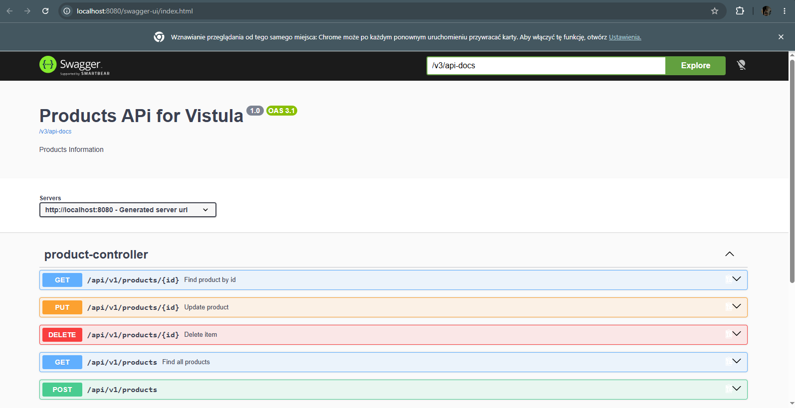
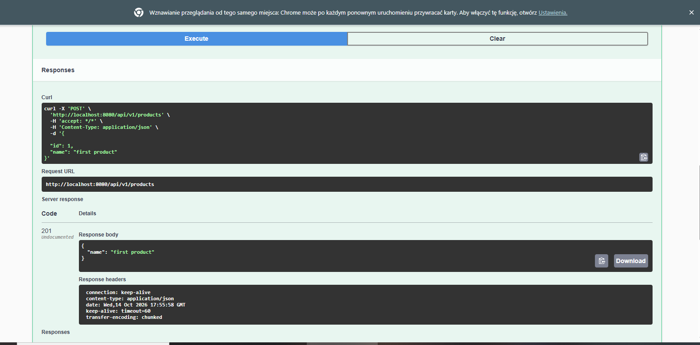
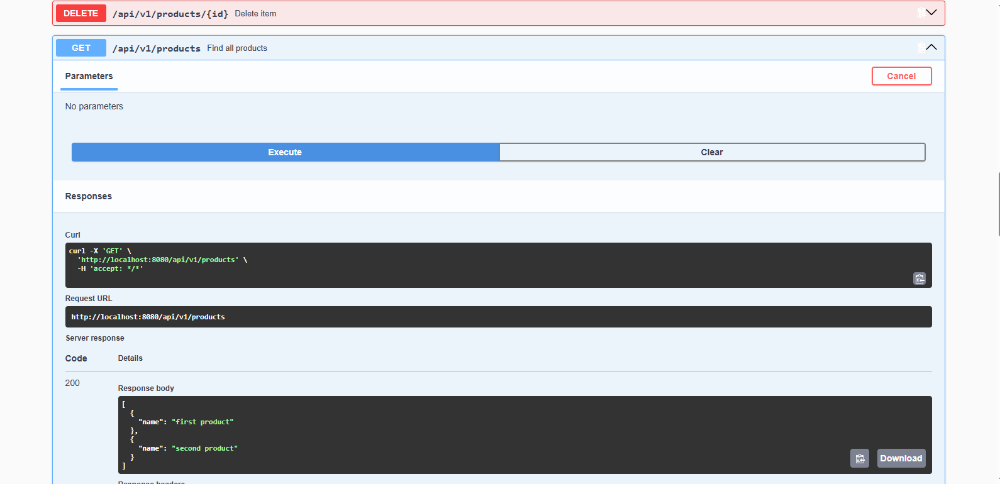
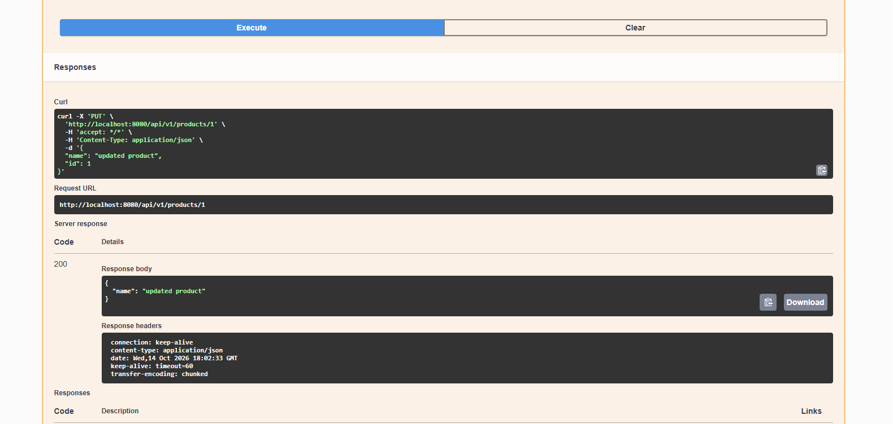
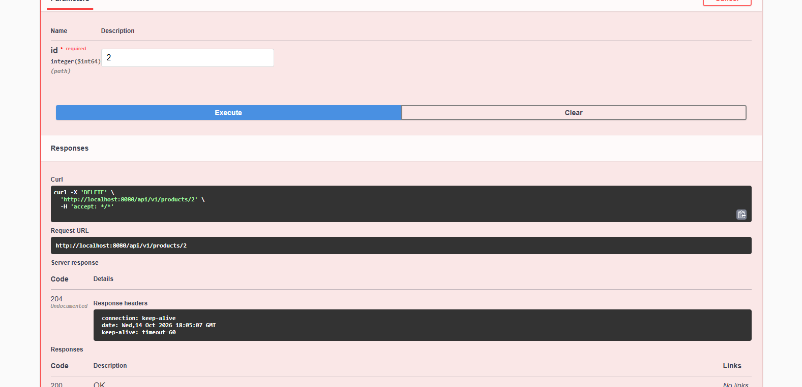

# Task 2 — Product REST API with Spring Boot
# By Nokutenda Prince Mahembe 64215
## 1. Project Overview

This project is a REST API developed using Java and Spring Boot. It manages products and demonstrates how an application receives HTTP requests, processes data, and returns HTTP responses.

The API supports creating, retrieving, updating, and deleting products. It uses Spring Data JPA and an H2 in-memory database to store product data.

Swagger UI is used to document and test the API endpoints.

## 2. Technologies Used

- Java
- Spring Boot
- Spring Web
- Spring Data JPA
- H2 Database
- Maven
- Swagger UI / OpenAPI
- IntelliJ IDEA

## 3. Application Structure

The application is organised into packages that separate different responsibilities.

- **ProductController:** Receives HTTP requests and returns responses.
- **ProductRequest:** Represents incoming product data.
- **UpdateProductRequest:** Represents data used when updating a product.
- **ProductResponse:** Represents product data returned to the client.
- **Product:** Represents a product stored in the database.
- **ProductService:** Contains the application's business logic.
- **ProductRepository:** Provides access to product data through Spring Data JPA.
- **ProductMapper:** Converts data between request objects, product objects, and response objects.
- **ProductNotFoundException:** Represents a situation where a requested product cannot be found.
- **ProductExceptionAdvisor:** Handles application exceptions and produces appropriate HTTP error responses.
- **application.properties:** Contains application configuration, including the H2 console and logging settings.

## 4. How to Run the Application

1. Open the project in IntelliJ IDEA.
2. Wait for Maven to download and load the required dependencies.
3. Run `FirstrestapispringApplication.java`.
4. Confirm that the application starts successfully.
5. Open Swagger UI or the H2 Console using the URLs below.

The application normally runs on port `8080`.

## 5. Swagger UI and API Documentation

### Swagger UI

**URL:** `http://localhost:8080/swagger-ui/index.html`

Swagger UI allows the API endpoints to be tested directly from the browser.



### OpenAPI Documentation

**URL:** `http://localhost:8080/v3/api-docs`

This endpoint displays the generated OpenAPI specification in JSON format.

## 6. API Endpoints and Use Cases

The base endpoint for product operations is:

`/api/v1/products`

### Use Case 1: Create a Product

- **HTTP method:** POST
- **Endpoint:** `/api/v1/products`
- **Expected successful status:** `201 Created`

In Swagger UI, select the POST endpoint, click **Try it out**, and submit a JSON request body such as:

```json
{
  "name": "I don't remember what I typed here"
}
```

The application creates the product and returns the created product information.



### Use Case 2: Retrieve a Product by ID

- **HTTP method:** GET
- **Endpoint:** `/api/v1/products/{id}`
- **Expected successful status:** `200 OK`

Replace `{id}` with the ID of an existing product. The API returns the details of that product.


### Use Case 3: Retrieve All Products

- **HTTP method:** GET
- **Endpoint:** `/api/v1/products`
- **Expected successful status:** `200 OK`

This endpoint returns the products stored in the database.



### Use Case 4: Update a Product

- **HTTP method:** PUT
- **Endpoint:** `/api/v1/products/{id}`
- **Expected successful status:** `200 OK`

Replace `{id}` with the ID of the product to update. Submit the update request using the fields required by `UpdateProductRequest`, for example:

```json
{
  "id": 1,
  "name": "Updated thing I don't remember typing."
}
```

Use the actual product ID in your test. After updating, retrieve the product again to confirm that its name has changed.



### Use Case 5: Delete a Product

- **HTTP method:** DELETE
- **Endpoint:** `/api/v1/products/{id}`
- **Expected successful status:** `204 No Content`

Replace `{id}` with the ID of the product to delete. A successful delete request returns no response body. You can then retrieve all products to confirm that the deleted product is no longer listed.



### Use Case 6: Handle a Product That Does Not Exist

Try retrieving a product using an ID that does not exist.

The application should return a `404 Not Found` response and an error message handled by the exception-handling classes.


## 7. H2 Database Console

**URL:** `http://localhost:8080/console`

The H2 Console provides a browser-based interface for viewing and querying the database.

Use the following connection details, assuming they match the application's configuration:

- **JDBC URL:** `jdbc:h2:mem:testdb`
- **Username:** `sa`
- **Password:** Leave blank


### SQL Query: View All Products

After connecting, execute:

```sql
SELECT * FROM PRODUCTS;
```

This query displays the products stored in the `PRODUCTS` table.


Because the application uses an in-memory H2 database, its data normally disappears when the application stops.

## 8. HTTP Status Codes

| Status code | Meaning |
|---|---|
| `200 OK` | The request succeeded. |
| `201 Created` | A product was created successfully. |
| `204 No Content` | A product was deleted successfully. |
| `404 Not Found` | The requested product does not exist. |

## 9. Conclusion

This project demonstrates the development and testing of a REST API using Spring Boot. It implements the main product operations using HTTP methods, separates responsibilities across controller, service, repository, and supporting classes, and uses Spring Data JPA with an H2 in-memory database. Swagger UI provides a convenient way to test the endpoints, while the H2 Console allows the stored data to be inspected using SQL queries.
